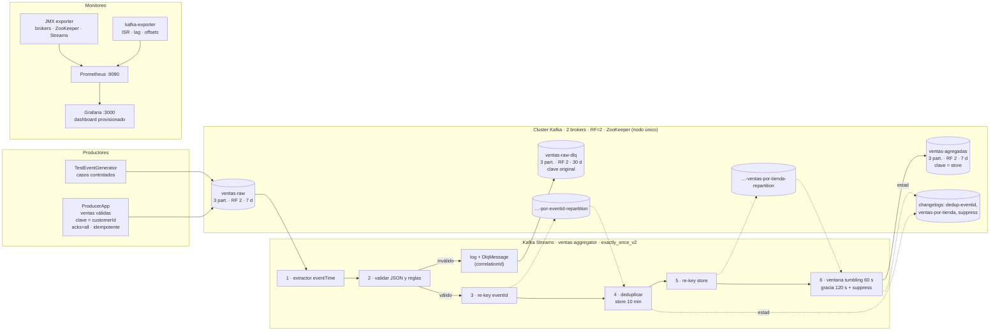

# Streaming resiliente de ventas · Kafka Streams

DSY1107 Desarrollo Cloud Native I · Evaluación Parcial N°5 — *Integración, validación y recuperación con Kafka Streams*.

Pipeline de ventas que **valida** cada evento, envía los inválidos a una **DLQ** con su causa, **deduplica** por `eventId`, **agrega por tienda en ventanas por tiempo de evento** con período de gracia y se **recupera** de la caída de un broker o del consumidor sin pérdida silenciosa. Todo corre con Docker Compose (Kafka, ZooKeeper, la aplicación y el monitoreo), en local y en AWS con el mismo `docker-compose.yaml`.

---

## 1. Arquitectura



| Servicio | Imagen | Puertos (host) | Función |
|---|---|---|---|
| `zookeeper` | cp-zookeeper 7.6.14 | — | Metadatos del cluster (**punto único de falla**) |
| `kafka-1`, `kafka-2` | cp-kafka 7.6.14 | 9092, 9093 | Brokers. Red interna `kafka-N:29092` |
| `kafka-init` | cp-kafka 7.6.14 | — | Crea los tópicos (idempotente) y termina |
| `streams` | `ventas-app` (./app) | — | Aplicación Kafka Streams `ventas-aggregator` |
| `producer`, `generator`, `tests` | `ventas-app` / maven | — | Herramientas (`profiles: ["tools"]`) |
| `prometheus` | prom/prometheus v2.55.1 | 9090 | Métricas |
| `grafana` | grafana/grafana 11.3.1 | 3000 | Dashboard *Ventas Streaming - Kafka* |
| `kafka-exporter` | danielqsj/kafka-exporter v1.8.0 | — | Brokers, ISR, lag de consumer groups |
| `kafka-ui` (opcional) | provectuslabs/kafka-ui v0.7.2 | 8080 | Perfil `ui` |

### Eventos y claves

**Venta (`ventas-raw`)**, DTO [`Sale`](app/src/main/java/cl/duoc/ventas/Sale.java):

```json
{"eventId":"7b1c…","eventTime":"2026-11-21T16:00:06Z","store":"Paris Online","storeFormat":"online","city":"Santiago",
 "channel":"web","category":"ropa","product":"Jeans slim","quantity":2,"unitPriceClp":19990,"totalClp":39980,
 "customerId":"cliente-0042","paymentMethod":"débito"}
```

**Agregado (`ventas-agregadas`)**, [`WindowResult`](app/src/main/java/cl/duoc/ventas/WindowResult.java):
`{"store":"Paris Online","window_start":"…T16:00:00Z","window_end":"…T16:01:00Z","sales_count":12,"total_clp":425161,"avg_ticket_clp":35430}`

**Rechazo (`ventas-raw-dlq`)**, [`DlqMessage`](app/src/main/java/cl/duoc/ventas/DlqMessage.java):
`{"correlationId":"ae83…","sourceTopic":"ventas-raw","key":"cliente-0042","originalValue":"<texto exacto recibido>","reason":"TOTAL_INCONSISTENTE: esperado=2000 recibido=5000","detectedAt":"…"}`

| Tópico | Clave | Justificación |
|---|---|---|
| `ventas-raw` | `customerId` | Orden garantizado por cliente (todas sus ventas en la misma partición) y buena distribución (200 clientes en 3 particiones). |
| repartition interno 1 | `eventId` | Todas las copias de una venta llegan a la **misma tarea** para poder deduplicarlas con su estado. |
| repartition interno 2 / `ventas-agregadas` | `store` | La agregación es por tienda: cada tienda queda en una tarea; el consumidor de agregados lee por tienda. |
| `ventas-raw-dlq` | clave original | Trazabilidad: el rechazo queda asociado al mismo cliente/partición lógica que el evento original. |

---

## 2. Decisiones de diseño (justificadas)

| Tema | Decisión | Por qué |
|---|---|---|
| Particiones | 3 por tópico | Paralelismo de hasta 3 tareas por subtopología; líderes repartidos entre los 2 brokers. |
| Replicación | **RF = 2** | Máximo posible con 2 brokers (**RF=3 es imposible**). Cada partición sobrevive a la caída de un broker. |
| `min.insync.replicas` | **1** (configurable) | Prioriza **disponibilidad**: con un broker caído se sigue produciendo con `acks=all`. Con `2` se prioriza **durabilidad**: la producción se bloquea (`NotEnoughReplicas`). Ambos modos demostrados (evidencia 09). |
| Log transaccional | `transaction.state.log.replication.factor=2`, `min.isr=1` | Con EOS v2 las transacciones deben seguir funcionando con un broker caído; con `min.isr=2` se bloquearían. |
| Retención | 7 d (`raw`, `agregadas`), **30 d** (`dlq`) | La DLQ necesita más tiempo para investigar y reprocesar. |
| Ventana | Tumbling **60 s** por `eventTime` | Granularidad de reporte por minuto; el extractor usa el campo `eventTime`, no la hora de llegada. |
| Gracia | **120 s** | Debe cubrir el desfase del productor **y el reordenamiento al procesar el atraso tras una caída del consumidor**. Con 30 s, un reinicio de ~35 s descartó 22 ventas como tardías (hallazgo documentado en la evidencia 10a); con 120 s el mismo escenario coincide 100 % (evidencia 10). Costo: la ventana se publica 3 min después de abrir. |
| Publicación | `suppress(untilWindowCloses)` | Un único resultado final por ventana (no actualizaciones parciales). |
| Deduplicación | Store `eventId → eventTime`, retención **10 min**, purga por *punctuator* de stream time | 10 min ≥ ventana + gracia (3 min): una copia más tardía cae en una ventana ya cerrada y se descarta igual; memoria acotada (~3.000 ids a 5 ventas/s). Store persistente con changelog: sobrevive reinicios. |
| Semántica | `processing.guarantee=exactly_once_v2` + productor `acks=all` + idempotente | Ver sección 6. |
| Configuración | Clase única [`AppConfig`](app/src/main/java/cl/duoc/ventas/AppConfig.java) + `.env` | Todo valor ajustable por variable de entorno, sin recompilar. La app imprime su configuración efectiva al arrancar (`Kafka Streams config …`). |

---

## 3. Prerrequisitos

- **Docker Desktop** (o Docker Engine + plugin Compose v2). **No se necesita Java ni Maven**: se compila y se prueba dentro de contenedores.
- ~4 GB de RAM libres para Docker.
- Windows: PowerShell 5.1+ (scripts `.ps1`) y Git Bash para los escenarios `.sh`. Linux/macOS: bash.
- AWS (opcional): AWS CLI v2 y credenciales temporales en variables de entorno (sección 9).

---

## 4. Puesta en marcha

> Atajo: `levantar-local.bat`. Todos los comandos de prueba en [docs/COMANDOS.md](docs/COMANDOS.md).

```powershell
# 1) Configuración (valores por defecto documentados; no contiene secretos)
Copy-Item .env.example .env            # Linux/macOS: cp .env.example .env

# 2) Levantar todo: ZooKeeper, 2 brokers, creación de tópicos, Streams, Prometheus, Grafana
docker compose up -d --build

# 3) Verificar
docker compose ps -a                   # kafka-init y jmx-agent: Exited (0); el resto Up / healthy
docker logs ventas-streams 2>&1 | findstr "Kafka Streams config"    # Linux: | grep

# 4) Producir ventas válidas (Ctrl+C para detener) o una cantidad fija
docker compose run --rm producer
docker compose run --rm -e PRODUCER_MAX_EVENTS=50 producer

# 5) Ver resultados
powershell -ExecutionPolicy Bypass -File scripts\kafka.ps1 agregadas
```

- Grafana: <http://localhost:3000> (lectura anónima; admin `admin` / `GRAFANA_ADMIN_PASSWORD`). Prometheus: <http://localhost:9090/targets>.
- Kafka UI (opcional): `docker compose --profile ui up -d kafka-ui` → <http://localhost:8080>.
- Detener sin borrar datos: `docker compose down`. **`docker compose down -v` borra todos los datos** (tópicos, estado, métricas).

### Variables configurables (`.env`)

| Variable | Por defecto | Uso |
|---|---|---|
| `PUBLIC_HOST` | `localhost` | Host anunciado a clientes externos (en AWS: IP pública) |
| `RAW_TOPIC` / `AGG_TOPIC` / `DLQ_TOPIC` | `ventas-raw` / `ventas-agregadas` / `ventas-raw-dlq` | Nombres de tópicos |
| `TOPIC_PARTITIONS` / `TOPIC_REPLICATION_FACTOR` | 3 / 2 | Creación de tópicos y RF de tópicos internos de Streams |
| `MIN_INSYNC_REPLICAS` | 1 | Broker y tópicos (al crearlos) |
| `RAW_RETENTION_MS` / `AGG_RETENTION_MS` / `DLQ_RETENTION_MS` | 7 d / 7 d / 30 d | Retención |
| `GROUP_ID` | `ventas-aggregator` | `application.id` = consumer group |
| `WINDOW_SECONDS` / `WINDOW_GRACE_SECONDS` | 60 / 120 | Ventana y gracia |
| `DEDUP_RETENTION_MINUTES` | 10 | Memoria de `eventId` |
| `COMMIT_INTERVAL_MS` | 1000 | Commit de transacciones de Streams |
| `PRODUCE_INTERVAL` / `PRODUCER_MAX_EVENTS` / `CUSTOMER_POOL` | 1.0 / 0 / 200 | Productor |
| `GRAFANA_ADMIN_PASSWORD`, `GRAFANA_PORT`, `PROMETHEUS_PORT`, `KAFKA_UI_PORT`, `KAFKA_HEAP_OPTS` | ver `.env.example` | Monitoreo y memoria |

Cambiar un valor = editar `.env` + `docker compose up -d` (recrea solo lo afectado). `kafka-init` usa `--if-not-exists`: **no modifica tópicos existentes** (para eso: `scripts\kafka.ps1 min-isr 2` o `kafka-configs --alter`).

---

## 5. Operación: tópicos, ISR, consumer groups

`scripts\kafka.ps1 <acción>` (Windows) o `./scripts/kafka.sh <acción>` (Linux/Git Bash):

| Acción | Muestra |
|---|---|
| `estado` | Servicios y brokers registrados en ZooKeeper |
| `topicos` / `topicos-todos` | Particiones, líder, réplicas, **ISR** / lista con tópicos internos |
| `isr` | ISR + particiones sub-replicadas + bajo `min.insync.replicas` |
| `config` | Retención, `min.insync.replicas`, `cleanup.policy`… con su origen (tópico/broker/defecto) |
| `grupos` | Consumer groups, offsets, **lag** y miembros |
| `raw` / `agregadas` / `dlq [N]` | Mensajes con clave, partición y offset |
| `logs` | Rechazos, duplicados, descartes por tardío, restauración |
| `min-isr 1\|2` | Cambia `min.insync.replicas` de los 3 tópicos |

Guardar cualquier salida como evidencia: `scripts\evidencia.ps1 <NN-nombre> "<comando>"` (o `scripts/evidencia.sh`). Las claves AWS que aparezcan se reemplazan por `<REDACTADO>`.

---

## 6. Validación, DLQ, duplicados y tiempo

**Validación** ([`SaleValidator`](app/src/main/java/cl/duoc/ventas/SaleValidator.java)): `VALOR_VACIO`, `JSON_INVALIDO: <excepción>`, `CAMPO_OBLIGATORIO_AUSENTE: eventId|eventTime|store`, `EVENTTIME_INVALIDO`, `CANTIDAD_INVALIDA`, `PRECIO_INVALIDO`, `TOTAL_INCONSISTENTE: esperado=… recibido=…`. Un inválido **no detiene** la app: se escribe en la DLQ con el valor original **sin modificar**, la clave, el tópico fuente, el motivo y un `correlationId` que también aparece en el log `WARN evento rechazado correlationId=… topico=… clave=… motivo=…`.

**Duplicados y semántica de entrega**:
- `acks=all` + `enable.idempotence=true` en el productor: un **reintento de red** del mismo envío no se escribe dos veces (el broker descarta por número de secuencia).
- `exactly_once_v2` en Streams: lectura, actualización de estado y escritura van en **una transacción**. Si la app falla a mitad de camino, la transacción se aborta y se reprocesa desde el último offset confirmado: **un mismo registro** no produce efectos dobles.
- Ninguno de los dos detecta **dos eventos de negocio** con el mismo `eventId` (p. ej. la caja envía la venta dos veces): para Kafka son **dos registros distintos** con offsets distintos (evidencia 03: offsets 27, 28, 29). Eso lo resuelve el [`DeduplicadorPorEventId`](app/src/main/java/cl/duoc/ventas/DeduplicadorPorEventId.java): re-key por `eventId`, store con retención de 10 min, log `duplicado ignorado eventId=… origen=<tópico-partición@offset>` y métrica `duplicados-ignorados-total`.

**Eventos tardíos** (política):

| Caso | Qué pasa | Cómo se detecta |
|---|---|---|
| Fuera de orden **dentro** de la gracia (≤ 120 s tras el fin de su ventana) | Se **incorpora** a su ventana | Aparece en el agregado de esa ventana |
| **Después** de la gracia | Kafka Streams lo **descarta** | Log `WARN Skipping record for expired window … expiration=… streamTime=…` y métrica `dropped-records-total` (panel *Tardíos descartados* en Grafana) |
| Cualquier tardío | **No** va a la DLQ | Un tardío es un dato válido que llegó tarde, no un JSON inválido |

---

## 7. Escenarios de prueba (matriz)

Índice completo con fecha y entorno: [`evidencias/INDEX.md`](evidencias/INDEX.md).

| # | Escenario | Comando | Resultado esperado | Evidencia |
|---|---|---|---|---|
| 1 | Mensaje inválido (6 tipos) | `docker compose run --rm generator invalidos` + `scripts\kafka.ps1 dlq` + `scripts\kafka.ps1 logs` | App sigue `RUNNING`; DLQ con original, clave, tópico y causa; log con el mismo `correlationId` | [01](evidencias/01-dlq.txt), [05](evidencias/05-generador-metricas.txt) |
| 2 | Duplicado | `docker compose run --rm generator duplicados` | 3 registros en `ventas-raw`, 2 `duplicado ignorado`, agregado `sales_count=1` | [03](evidencias/03-dedup.txt), [05](evidencias/05-generador-metricas.txt) |
| 3 | Tardío dentro y fuera de gracia | `docker compose run --rm generator tardios` | Dentro: sumado a su ventana. Fuera: `Skipping record for expired window`, +1 en `dropped-records`, no en DLQ | [04](evidencias/04-tardios.txt), [05](evidencias/05-generador-metricas.txt) |
| 4 | Broker 2 detenido | `bash scripts/prueba-broker-caido.sh` | ISR `1,2`→`1`→`1,2`; con min ISR 1 se produce, con 2 se bloquea; recuperación medida; confirmadas = nuevas en `ventas-raw` | [09](evidencias/09-broker-caido.txt) |
| 5 | Reinicio del consumidor | `bash scripts/prueba-reinicio-streams.sh` | Continúa desde offsets; restauración desde changelog (con y sin volumen); dedup sobrevive; ventanas publicadas = ventas crudas | [10](evidencias/10-reinicio-streams.txt), [10a](evidencias/10a-reinicio-gracia30-hallazgo.txt) |
| — | Todos los casos de entrada | `docker compose run --rm generator todos` (≈ 4 min) | Lo de 1, 2 y 3 en una ejecución | [05](evidencias/05-generador-metricas.txt) |
| — | Pruebas automatizadas | `docker compose run --rm tests` | `Tests run: 23, Failures: 0` | [08](evidencias/08-tests.txt) |

> **Tiempos**: un agregado se publica cuando el reloj del stream pasa *fin de ventana + gracia* (3 min). `suppress` necesita que **llegue un evento posterior**: el generador envía un evento "empujador" tras esperar; con el productor detenido la última ventana queda retenida.

### Pruebas automatizadas

`docker compose run --rm tests` (JUnit 5 + `TopologyTestDriver`, sin brokers; reportes en `app/target/surefire-reports`, resumen con `python scripts/reporte_tests.py`):

| Clase | Cubre |
|---|---|
| `SaleValidatorTest` | Cada motivo de rechazo (10 casos) y venta válida |
| `StreamsTopologyTest$Dlq` | Contenido completo de la DLQ; el flujo continúa con los válidos |
| `StreamsTopologyTest$Duplicados` | Mismo `eventId` ×3 cuenta 1; ids distintos sí cuentan; purga por retención |
| `StreamsTopologyTest$Agregacion` | Conteo, monto, ticket promedio, inicio/fin de ventana, uso de `eventTime` |
| `StreamsTopologyTest$Tardios` | `suppress` espera fin + gracia; tardío dentro se suma, fuera se descarta (+1 `dropped-records`), no va a DLQ |
| `AppConfigTest` | Valores por defecto y sobrescritura por entorno |

---

## 8. Monitoreo

Dashboard provisionado [*Ventas Streaming - Kafka*](monitoring/grafana/dashboards/ventas-streaming.json) (se abre como inicio de Grafana): brokers activos, particiones sub-replicadas y bajo min ISR, controller, targets `up`, ISR por partición, líderes por broker, mensajes/s por tópico, **lag por consumer group**, mensajes en DLQ, **tardíos descartados**, **duplicados ignorados**, hilos de Streams vivos, procesamiento y restauración, heap por servicio.

Fuentes: JMX exporter como *javaagent* dentro de los brokers, ZooKeeper y Streams (reglas en [`monitoring/jmx`](monitoring/jmx)); `kafka-exporter` para ISR, offsets y lag. El agente se activa solo en el proceso servidor (no en las herramientas CLI del contenedor). El dashboard se regenera con `python scripts/gen_dashboard.py monitoring/grafana/dashboards/ventas-streaming.json`.

---

## 9. Despliegue en AWS

Mismo `docker-compose.yaml`, una EC2 Ubuntu 24.04 con Docker instalado por *user-data*. La cuenta educativa **solo permite `t3.medium`** (4 GB; `t3.large`, `t2.large` y `m5.large` dan `UnauthorizedOperation`): se agregan 2 GB de swap y el `.env` del servidor baja el heap de los brokers a 384 MB (`KAFKA_HEAP_OPTS`). Scripts idempotentes y reanudables (estado sin secretos en `aws/estado.json`, ignorado por git):

**En un paso** (guía completa en [docs/COMANDOS.md](docs/COMANDOS.md)): pegar el bloque `[default]` de *AWS Details* en `aws\credenciales.txt` (ignorado por git; plantilla `aws\credenciales.ejemplo.txt`) y ejecutar `desplegar-aws.bat` (o `desplegar-aws.bat pruebas` para correr además todos los escenarios y traer las evidencias). `pruebas-aws.bat <escenario>` repite un escenario y `destruir-aws.bat` elimina todo.

Paso a paso:

```powershell
# Credenciales temporales SOLO en variables de entorno de la terminal (nunca en archivos ni en el repo)
$env:AWS_ACCESS_KEY_ID="..."; $env:AWS_SECRET_ACCESS_KEY="..."; $env:AWS_SESSION_TOKEN="..."; $env:AWS_DEFAULT_REGION="us-east-1"

powershell -ExecutionPolicy Bypass -File aws\00-verificar.ps1 -NuevasCredenciales   # identidad, permisos, AMI, tu IP
powershell -ExecutionPolicy Bypass -File aws\01-red-seguridad.ps1   # security group SOLO a tu IP /32 + key pair (~/.ssh)
powershell -ExecutionPolicy Bypass -File aws\02-instancia.ps1       # EC2 t3.medium + Docker + swap
powershell -ExecutionPolicy Bypass -File aws\03-despliegue.ps1      # copia el repo, crea .env con PUBLIC_HOST=<IP>, compose up
powershell -ExecutionPolicy Bypass -File aws\04-evidencias.ps1      # escenarios en la EC2 y trae evidencias *-aws
powershell -ExecutionPolicy Bypass -File aws\99-destruir.ps1        # borra instancia, disco, SG y key pair; verifica
```

- Los scripts **ignoran `~/.aws/credentials`**: solo usan las variables de la terminal. No imprimen claves ni el ARN completo.
- `desplegar-aws.bat` abre **22 (SSH), 3000 (Grafana) y 9090 (Prometheus) a todo internet** para poder presentar desde cualquier red (SSH exige la llave `.pem`; Grafana es de solo lectura y su admin recibe una clave aleatoria). **Kafka (9092-9093) y Kafka UI (8080) quedan solo a tu IP /32**: no tienen autenticación ni TLS. Sin `-AbrirATodos` (scripts por separado) todo queda restringido a tu IP. Es una exposición **temporal**: destruir con `destruir-aws.bat` al terminar.
- Si vencen las credenciales (~3 h), exporta las nuevas, ejecuta `00-verificar.ps1 -NuevasCredenciales` y retoma el paso donde quedó.

---

## 10. Límites conocidos

- **ZooKeeper de un solo nodo** es un punto único de falla: si cae, no hay elección de líderes ni cambios de metadatos.
- **Dos brokers en una sola máquina** (local o una EC2) no dan tolerancia a la falla del nodo físico; solo a la caída de un proceso broker.
- **RF=3 es imposible** con 2 brokers. Con `min.insync.replicas=2` y un broker caído, la producción con `acks=all` se bloquea y las transacciones de Streams que escriben en esos tópicos se abortan por timeout (la app se recupera sola al volver el broker o bajar a 1; evidencia 09).
- `suppress(untilWindowCloses)` retiene la **última ventana** hasta que llegue un evento posterior a *fin + gracia*.
- El **tiempo de stream** es por tarea (partición). Se conserva tras un reinicio (evidencia 10, parte C), pero al procesar el atraso de una caída las particiones avanzan a distinto ritmo: una caída del consumidor **más larga que la gracia (120 s)** puede descartar ventas como tardías (detectable en log y `dropped-records`; evidencia 10a con gracia 30 s).
- El extractor confía en `eventTime`: un evento **válido** con fecha futura adelanta el reloj de su tarea y puede hacer descartar eventos normales. Los eventos **inválidos** no afectan las ventanas (se separan antes del repartition por tienda).
- La deduplicación recuerda un `eventId` **10 min** (por tiempo de evento); una copia posterior con un `eventTime` nuevo se contaría.
- Las métricas `dropped-records` y `duplicados-ignorados` son contadores en memoria: se reinician con la app (Prometheus conserva el historial).
- Kafka sin autenticación ni cifrado (entorno académico).

---

## 11. Recuperación (runbook)

| Síntoma | Causa probable | Acción |
|---|---|---|
| Un broker no arranca: `NodeExists … /brokers/ids/N` | Sesión anterior aún registrada en ZooKeeper | Esperar ~40 s (expira la sesión) y `docker compose up -d` |
| `kafka-init` falla | Brokers aún no sanos | `docker compose up -d` de nuevo (es idempotente) |
| Productor bloqueado, `NOT_ENOUGH_REPLICAS` | `min.insync.replicas=2` con un broker caído | Levantar el broker (`docker compose start kafka-2`) o `scripts\kafka.ps1 min-isr 1` |
| Particiones sub-replicadas | Broker caído o poniéndose al día | `scripts\kafka.ps1 isr` hasta que el ISR sea `1,2` |
| Todos los líderes en un broker tras reiniciar el otro | Normal tras una caída | Esperar el rebalanceo automático (5 min) o `kafka-leader-election --election-type preferred --all-topic-partitions` |
| Streams en `ERROR` o sin hilos vivos | Error no recuperable | `docker compose restart streams` (restaura desde changelog y continúa desde offsets) |
| Estado local corrupto | Disco / volumen | `docker compose rm -sf streams`, borrar el volumen `*_streams-state`, `docker compose up -d streams` (reconstrucción completa desde changelog) |
| Ventas descartadas como tardías tras una caída larga | Caída del consumidor > gracia | Revisar `dropped-records`; reprocesar con `kafka-streams-application-reset` si se requiere el agregado exacto |
| AWS: `ssh` termina con código 255 a mitad de los escenarios | La sesión del laboratorio venció: AWS detuvo/eliminó la instancia | Nuevas credenciales → `00-verificar.ps1 -NuevasCredenciales` → `01`…`04` (idempotentes, recrean lo que falte) |
| AWS: `Docker no quedo listo` pero la instancia está `running` | `.pem` local distinto de la llave de AWS | `01-red-seguridad.ps1` (reemplaza la llave) y recrear la instancia |
| No aparece el último agregado | `suppress` espera fin + gracia | Producir un evento posterior (p. ej. `docker compose run --rm -e PRODUCER_MAX_EVENTS=5 producer`) |

---

## 12. Estructura

```
app/                      código Java 21 (Kafka 3.9.2) + Dockerfile multi-stage + pruebas
  src/main/java/cl/duoc/ventas/
    AppConfig             configuración centralizada (entorno + valores por defecto)
    StreamsApp            topología: validación → DLQ, dedup, ventanas
    SaleValidator, SaleTimestampExtractor, DeduplicadorPorEventId, JsonSerde
    Sale, DlqMessage, TicketAggregate, WindowResult   (DTOs)
    ProducerApp, TestEventGenerator                   (productores)
  src/test/java/…         JUnit 5 + TopologyTestDriver
monitoring/               reglas JMX, Prometheus, Grafana (datasource + dashboard provisionados)
scripts/                  kafka.ps1|sh, evidencia.ps1|sh, prueba-broker-caido.sh, prueba-reinicio-streams.sh,
                          verificar_consistencia.py, reporte_tests.py, gen_dashboard.py
aws/                      00-verificar … 99-destruir (PowerShell)
evidencias/               salidas de comandos (INDEX.md)
docker-compose.yaml, .env.example
```
